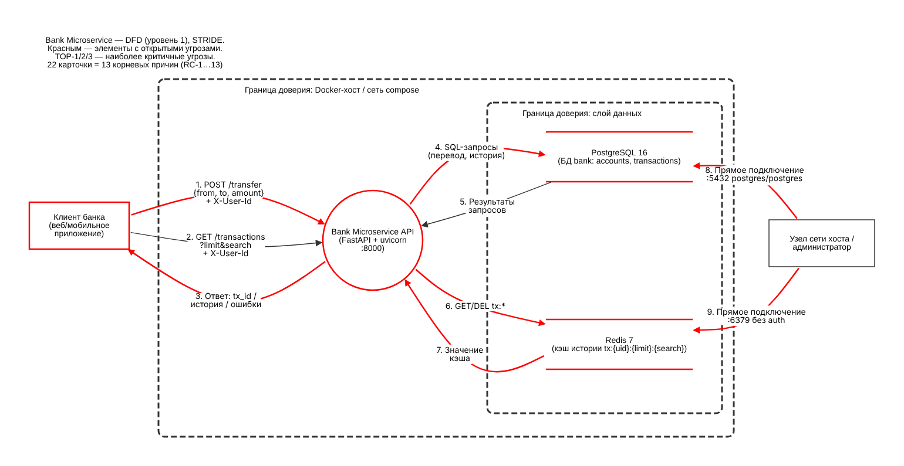

# Модуль B «Защита ИТ-инфраструктуры» — банковский микросервис

*Редакция 3 (2026-11-25): исправления ИСПР-11…14 по второму аудиту, см. `AUDIT_FIXES.md`. Оригинал организатора — `microservice.zip`, SHA-256 `b34bebec03ce185cbfc7bfbf5f21cf2dffcc7a1e77ca8eb5c548421ec46458b3`. Все контрмеры в отчёте — **рекомендации**: в сервисе они не внедрены.*

**Объект:** микросервис перевода средств и просмотра истории транзакций (`microservice.zip`, файлы от 2026-09-23): REST API на FastAPI, PostgreSQL 16, Redis 7, развёртывание через docker-compose. Код в `microservice/` не изменялся; совпадение с исходным архивом проверено по SHA-256 (`evidence/verification/microservice-sha256.txt`).

**Источники выводов:** ручной разбор кода, Semgrep (community-правила с закреплённой ревизией + 16 собственных), pip-audit, динамические проверки на локальном стенде (PostgreSQL 16 + Redis 7 + сервис на 127.0.0.1). Команды и логи — в `evidence/`, их перечень — в `evidence/README.md`. Изменения по замечаниям аудита — в `AUDIT_FIXES.md`.

**Как читать статусы:** «подтверждено» — есть доказательство в коде, конфигурации или логе стенда; «потенциальный риск» — слабость или пробел в материалах без подтверждённой эксплуатации; «не проверялось» — эксперимент не выполнялся.

> **Ограничение стенда.** В поставке сервис **не стартует**: `main.py` импортирует `user_id`, `TransferIn`, `TxOut`, а в модулях они называются `get_current_user_id`, `TransferRequest`, `TransactionOut` (ImportError). `docker-compose.yml` ссылается на `build: .`, но Dockerfile в архиве нет. Динамические проверки выполнялись через харнесс `evidence/scripts/run_app.py`, который подставляет алиасы перед импортом и не меняет код. Docker на стенде не было: PostgreSQL и Redis запущены локально, а не через `docker-compose.yml`, поэтому выводы о compose-конфигурации подтверждены анализом файла, а не подключением к опубликованным портам.

---

## 1. Модель угроз

Файлы в `threat-model/`:

| Файл | Что это |
|---|---|
| `bank-microservice.threatdragon.json` | Модель OWASP Threat Dragon v2 (DFD + 22 карточки STRIDE). Генерируется `tools/build_threat_model.py`, проходит схему Threat Dragon v2 |
| `threat-model-report.pdf` | Отчёт, напечатанный из **OWASP Threat Dragon 2.6.2** (web): Report → Печать, A4 альбомная (`tools/td_render_report.py`) |
| `dfd.png`, `dfd.svg` | Экспорт диаграммы из редактора Threat Dragon |
| `threat-register.md`, `threat-register.pdf` | Читабельный реестр из того же источника: корневые причины, все карточки, контрмеры с критериями эффективности. **Это не экспорт Threat Dragon** |

### 1.1 Data Flow Diagram



| Элемент DFD | Тип | Что это в коде |
|---|---|---|
| Клиент банка | Внешняя сущность | Вызывает API по HTTP и сам передаёт `X-User-Id` |
| Bank Microservice API | Процесс | `app/main.py` (FastAPI + uvicorn, :8000): `POST /transfer`, `GET /transactions` |
| PostgreSQL 16 | Хранилище | Таблицы `accounts(id, owner_user_id, balance_cents)` и `transactions` (`app/db.py`) |
| Redis 7 | Хранилище | Кэш истории, ключи `tx:{uid}:{limit}:{search}` (`app/crud.py`) |
| Узел сети хоста / администратор | Внешняя сущность | Появляется из-за опубликованных портов 5432 и 6379 (`docker-compose.yml`) |

Обмен между клиентом и API, API и PostgreSQL, API и Redis двунаправленный: на диаграмме он показан парами потоков «запрос» и «ответ».

| № | Поток | Данные | Протокол / защита (по предоставленной конфигурации) |
|---|---|---|---|
| 1 | Клиент → API | `POST /transfer {from_account_id, to_account_id, amount_cents}` + `X-User-Id` | HTTP; TLS не описан, аутентификации нет |
| 2 | Клиент → API | `GET /transactions?limit&search` + `X-User-Id` | HTTP; TLS не описан, аутентификации нет |
| 3 | API → Клиент | `transaction_id`, история, ошибки 400/403/404 | HTTP |
| 4 | API → PostgreSQL | Проверка владения, чтение баланса, 2×UPDATE, INSERT, SELECT истории | asyncpg; требование TLS с проверкой имени сервера явно не задано (`ssl=` нет, `sslmode` в DSN нет — asyncpg 0.29.0 использует `prefer`); фактическое шифрование не проверено; суперпользователь `postgres` |
| 5 | PostgreSQL → API | Баланс, строки `transactions` | — |
| 6 | API → Redis | `GET tx:{uid}:{limit}:{search}`, `DEL tx:{uid}` | RESP, без пароля и TLS |
| 7 | Redis → API | Значение кэша (при попадании API возвращает `[]`) | — |
| 8 | Узел сети → PostgreSQL | Прямое подключение :5432 под `postgres/postgres` | порт опубликован на всех интерфейсах |
| 9 | Узел сети → Redis | Прямое подключение :6379 | без аутентификации |

**Границы доверия:** (1) клиент/внешняя сеть ↔ Docker-хост; (2) приложение ↔ слой данных. В предоставленной конфигурации вторая граница проницаема: порты СУБД и кэша опубликованы на хосте.

### 1.2 Три наиболее критичные угрозы

**Как выбирал.** Каждую карточку оценивал по трём осям, которые требует задание:
1. **Импакт** — CVSS 3.1 по C/I/A.
2. **Поверхность атаки и предпосылки** — кто может атаковать и что для этого нужно.
3. **Влияние на банковский процесс** — деньги клиентов, целостность остатков, банковская тайна.

В топ-3 попали угрозы, максимальные по всем трём осям и **подтверждённые** кодом, конфигурацией или стендом.

| | TOP-1. IDOR/BOLA через `X-User-Id` | TOP-2. Race condition в переводе | TOP-3. Доступ к PostgreSQL/Redis в обход API |
|---|---|---|---|
| **Корневая причина** | RC-1: идентичность из клиентского заголовка (`app/security.py:3-13`); владение (`app/crud.py:5-13`) сверяется с этим же значением | RC-2: `SELECT balance_cents` без блокировки (`crud.py:22`), проверка в Python, отдельный `UPDATE` (`crud.py:32`); нет `CHECK (balance_cents >= 0)` | RC-3: `ports 5432:5432`, `6379:6379` (`docker-compose.yml:10-11, 17-18`), `postgres/postgres` (стр. 7-8, 23), Redis без пароля (стр. 24) |
| **Предпосылки** | Сетевой доступ к API; учётная запись не нужна; ID последовательные | Параллельные запросы **со своего** счёта; сохраняется и после исправления TOP-1 | Сетевой доступ к хосту |
| **Объект** | Перевод: счёт списания `from_account_id` и его владелец (проверка в `crud.py:5-13`, идентификатор владельца — из `X-User-Id`). История: исходящие операции счетов выбранного владельца — JOIN по счёту **отправителя**, `owner_user_id = $1`, не более `limit` ≤ 100 за запрос (`crud.py:52-65`); при непустом ключе Redis — пустой список (`crud.py:45-48`) | Остаток счёта списания и зачисление получателю | PostgreSQL (`accounts`, `transactions`) и Redis целиком |
| **Поверхность** | Оба эндпоинта; один HTTP-запрос | `POST /transfer` | Порты 5432, 6379 на всех интерфейсах |
| **C / I / A** | High / High / — | — / High / — | High / High / High |
| **CVSS 3.1** | 9.1 `AV:N/AC:L/PR:N/UI:N/S:U/C:H/I:H/A:N` | 7.5 `AV:N/AC:L/PR:N/UI:N/S:U/C:N/I:H/A:N` (6.5 при PR:L после TOP-1); бизнес-критичность — Critical | 9.8 `AV:N/AC:L/PR:N/UI:N/S:U/C:H/I:H/A:H` при доступе из внешней сети; 8.8 (AV:A) для внутреннего сегмента |
| **Бизнес-процесс** | Хищение средств с любого счёта; раскрытие исходящих операций любого владельца при подстановке его `X-User-Id` (банковская тайна) | Необеспеченные зачисления, риск финансовых потерь, расхождение остатков | Изменение балансов и истории, простой сервиса; атака проходит мимо проверок и журналов API |
| **Подтверждение** | `dynamic_checks.log:13-14` (шаг 2): с `X-User-Id: 1` → перевод со счёта 1, HTTP 200; `:17-18` (шаг 2b): одна исходящая операция пользователя 1. Это примеры отдельных ответов, а не наблюдение по всем клиентам | `race_check.log`: отрицательный остаток в **4 из 10** раундов (до −30 000); дополнительный прогон `race_invariant_check.log`: 8 из 10 | Конфигурация и Semgrep `bank.compose-*`; влияние записи в Redis на ответ API — шаг 7. Подключение к опубликованным портам **не выполнялось** (стенд без Docker) |

**Что именно подтверждает TOP-2.** Это наблюдение, а не вывод о деньгах в целом:
- **Подтверждено:** отрицательный остаток отправителя, то есть нарушен инвариант неотрицательного баланса. Получатель получает зачисление по каждой успешной операции: в `race_invariant_check.log` при остатке −10 000 у получателя прирост 20 000. Это **необеспеченное зачисление** на сумму отрицательного остатка.
- **Подтверждено:** сумма остатков по всем счетам в каждом раунде не меняется (последний столбец лога). Деньги в системе не «создаются»: проводки сбалансированы, но часть зачисления не обеспечена остатком отправителя.
- **Не проверялось:** вывод необеспеченных средств за пределы сервиса. Финансовые потери — **риск**, а не наблюдаемый факт.

#### Контрмеры и проверяемые критерии эффективности

<!-- GEN:top-measures -->
#### TOP-1. IDOR/BOLA: перевод с чужого счёта и чтение чужой истории через подмену X-User-Id

| Тип | Рекомендуемая контрмера (не внедрена) | Что снижает | Уровень | Проверяемый критерий эффективности |
|---|---|---|---|---|
| Техническая | OAuth2/OIDC: JWT от IdP, проверка подписи, iss/aud/exp; user_id = claim sub; заголовок X-User-Id отклоняется на шлюзе | Spoofing — первопричину IDOR (RC-1) | код + инфраструктура (шлюз) | запрос без токена или с X-User-Id вместо токена → 401 |
| Техническая | Объектная авторизация в том же SQL (WHERE id=$1 AND owner_user_id=$sub), deny-by-default, 404 для чужих объектов | EoP/BOLA, перебор ID | код | токен пользователя A + счёт B → 404, в accounts и transactions 0 изменений |
| Архитектурная | API-шлюз (TLS, валидация токенов, rate limit); подтверждение перевода вторым фактором; непредсказуемые ID счетов (UUID) | массовую эксплуатацию, кражу сессии, перебор | архитектура / инфраструктура | перевод без второго фактора не исполняется; перебор ID упирается в лимит |
| Процессная | Требование «авторизация на каждом эндпоинте»; негативные тесты A→B как блокирующий gate в CI; DAST с двумя учётками; security-ревью auth-кода | повторное появление BOLA | процесс SDLC | тест A→B выполняется в каждом MR; MR с регрессией не сливается |

#### TOP-2. Race condition (TOCTOU) в переводе: списание сверх остатка, отрицательный баланс

| Тип | Рекомендуемая контрмера (не внедрена) | Что снижает | Уровень | Проверяемый критерий эффективности |
|---|---|---|---|---|
| Техническая | Атомарное условное списание: UPDATE … SET balance=balance-$1 WHERE id=$2 AND owner_user_id=$3 AND balance>=$1 RETURNING … (0 строк → отказ) либо SELECT … FOR UPDATE с блокировкой счетов по возрастанию id | TOCTOU, повторное списание сверх остатка (RC-2) | код | race_check 10×30: 0 раундов с отрицательным остатком, ровно 1 успешный перевод на раунд |
| Техническая | CHECK (balance_cents >= 0), FOREIGN KEY transactions → accounts; при необходимости SERIALIZABLE с повтором | последствия любой логической ошибки | инфраструктура (схема БД) | UPDATE, уводящий баланс в минус, отклоняется СУБД (SQLSTATE 23514) |
| Архитектурная | Обязательный Idempotency-Key + UNIQUE; журнал проводок (ledger) и ежедневная сверка остатков с проводками | дубли операций, незамеченные расхождения | архитектура | сверка остатков и проводок без расхождений; повтор с тем же ключом не создаёт операцию |
| Процессная | Конкурентный тест переводов в CI; пункт ревью «финансовая операция атомарна»; алерт на отрицательный остаток; лимиты и антифрод | регрессию, позднее обнаружение | процесс SDLC / эксплуатация | тест в CI зелёный; алерт срабатывает на тестовом отрицательном остатке |

#### TOP-3. Доступ к PostgreSQL и Redis в обход API: опубликованные порты, пароль по умолчанию, Redis без пароля

| Тип | Рекомендуемая контрмера (не внедрена) | Что снижает | Уровень | Проверяемый критерий эффективности |
|---|---|---|---|---|
| Архитектурная | Убрать ports у postgres и redis; отдельная внутренняя сеть (internal: true / NetworkPolicy), доступ только от API; администрирование через bastion/VPN, bind 127.0.0.1 | доступность хранилищ злоумышленнику (RC-3) | инфраструктура | сканирование 5432/6379 с узла вне сети compose → closed/filtered |
| Техническая | Секреты из Docker secrets/Vault, не в VCS; уникальные пароли и ротация; роль приложения с правами только на accounts/transactions; Redis: ACL-пользователь, protected-mode, отключение CONFIG/FLUSHALL/MODULE | вход с паролем по умолчанию, повышение привилегий (RC-3, RC-4) | инфраструктура + конфигурация | вход postgres/postgres отклонён; роль приложения не может выполнить DDL; AUTH без пароля в Redis отклонён |
| Техническая | TLS к PostgreSQL (sslmode=verify-full) и Redis (rediss://) | перехват учётных данных и данных (RC-10) | инфраструктура | подключение без TLS отклоняется сервером (pg_hba hostssl, tls-auth-clients) |
| Процессная | Semgrep bank.compose-* и секрет-сканинг как блокирующий gate; запрет паролей по умолчанию в стандарте конфигурирования; регулярное сканирование периметра | повторную ошибку конфигурации | процесс SDLC / эксплуатация | MR с ports: 5432/6379 или паролем-литералом падает на gate |
<!-- /GEN:top-measures -->

**SQL Injection: расхождение с формулировкой задания.** Задание указывает на SQL Injection. Для версии с SHA-256 `b34bebec03ce185cbfc7bfbf5f21cf2dffcc7a1e77ca8eb5c548421ec46458b3` три сигнала Semgrep проверены по коду. Пользовательские значения передаются параметрами, поэтому SQL Injection в этом запросе не подтверждена.

| Сигнал Semgrep | Позиция | Что в коде |
|---|---|---|
| `semgrep.bank.dynamic-sql-fstring` | `app/crud.py:61` | `sql += f" AND CAST(t.id AS TEXT) ILIKE ${i}"` — в строку попадает номер плейсхолдера `i`, целое число из функции (стр. 59, 63); значение `search` добавляется в `params` (стр. 62) |
| `semgrep.bank.dynamic-sql-fstring` | `app/crud.py:64` | `sql += f" ORDER BY t.created_at DESC LIMIT ${i}"` — то же; значение `limit` добавляется в `params` (стр. 65), валидировано `Query(ge=1, le=100)` (`main.py:21`) |
| `community-rules.python.lang.security.audit.sqli.asyncpg-sqli` | `app/crud.py:66` | `return await conn.fetch(sql, *params)` — значения передаются связуемыми параметрами asyncpg |

- **Основание вывода — путь данных по коду** (таблица выше). Триаж всех трёх записей — «false positive по эксплуатируемости»; записи сохранены в `semgrep-raw.json` и `semgrep-results.json`.
- **Наблюдения стенда — только иллюстрация.**
  - `evidence/dynamic_checks.log:25-26`: payload `' OR '1'='1` — тело ответа `[]`, HTTP 200, около 4 мс.
  - `:27-28`: payload `1'; SELECT pg_sleep(3)--` — HTTP 200, около 2,4 мс; тело ответа не сохранено (`-o /dev/null`).
- **В модели** это карточка #5 «Потенциальная регрессия к SQL Injection» (RC-5): статус Open, критичность Medium. Параметризация действует сейчас. Риск в том, что небезопасная правка (`f"... '{search}'"`) откроет инъекцию, а работа под суперпользователем (#9) сделает импакт максимальным.
- **Рекомендации на случай регрессии** (не внедрены): gate по `bank.dynamic-sql-fstring`, роль БД без DDL, DAST (sqlmap) на стенде.

### 1.3 Количество угроз: карточки и корневые причины

<!-- GEN:summary -->
Карточек угроз в Threat Dragon: **22** (сценарии STRIDE на элементах DFD); статус: Open — 22, Mitigated — 0. Открытые по критичности: Critical — 5, High — 4, Medium — 11, Low — 2.

Независимых корневых причин: **13** — 11 подтверждены материалами (код, конфигурация, стенд), 2 — потенциальные риски без подтверждённой эксплуатации (RC-5, RC-13).
<!-- /GEN:summary -->

Карточки Threat Dragon — это отдельные сценарии STRIDE на элементах DFD. Они полезны раздельно: у элемента, потока и хранилища разные меры и разные владельцы. Но несколько карточек могут выражать одну корневую причину: например, #1 и #4 — это RC-1, #3, #15, #20, #21, #22 — RC-3, #8 и #13 — RC-8. В каждой карточке есть метка `[RC-n]` и «Связано: #…».

<!-- GEN:rc-table -->
| RC | Корневая причина | Статус | Карточки TD | Причина → сценарий → последствие |
|---|---|---|---|---|
| RC-1 | Идентичность клиента берётся из заголовка X-User-Id без аутентификации | подтверждено (код, стенд) | #1, #4 | клиентский заголовок → подмена пользователя → IDOR → хищение средств, раскрытие истории |
| RC-2 | Проверка и списание баланса неатомарны, в схеме нет ограничений целостности | подтверждено (код, стенд) | #2, #17 | параллельные переводы → отрицательный остаток → необеспеченные зачисления → риск финансовых потерь |
| RC-3 | Хранилища доступны в обход API: опубликованные порты, пароль по умолчанию, Redis без аутентификации | подтверждено (конфигурация) | #3, #15, #20, #21, #22 | сетевой доступ к хосту → вход в СУБД/Redis → изменение балансов и истории, сброс кэша |
| RC-4 | Избыточные привилегии учётной записи БД, учётные данные в конфигурации | подтверждено (конфигурация) | #9, #14 | компрометация API или будущая SQLi → права суперпользователя СУБД |
| RC-5 | Динамическая сборка SQL (f-строки) при действующей bind-параметризации | потенциальный риск: эксплуатация не обнаружена | #5 | небезопасная правка кода → SQL Injection → чтение/изменение данных |
| RC-6 | Недостаточный аудит операций в приложении и в СУБД | подтверждено (код, конфигурация) | #6, #18 | атака без следов инициатора → невозможность расследования и доказательства |
| RC-7 | Нет ограничения частоты запросов, тяжёлый поиск ILIKE | подтверждено (код); DoS не проверялся | #7 | массовые запросы → исчерпание пула БД → недоступность |
| RC-8 | Лишняя информация в ответах и интерфейсе API | подтверждено (код; наблюдения стенда) | #8, #13 | отдельный ответ 404 для отсутствующего получателя, открытая схема API → перебор счетов, разведка |
| RC-9 | Уязвимые и незакреплённые зависимости и образы | подтверждено (pip-audit, конфигурация) | #10 | известная CVE в зависимости → DoS/иное воздействие на API |
| RC-10 | Защита каналов не задана в конфигурации: API и Redis — без TLS; для PostgreSQL явно не задано требование TLS с проверкой имени сервера (фактическое шифрование не проверено) | подтверждено (конфигурация) | #11, #14, #15 | перехват или подмена в сети → раскрытие идентификаторов, данных и учётных данных |
| RC-11 | Нет идемпотентности перевода | подтверждено (код, стенд) | #12 | повтор запроса → повторное списание |
| RC-12 | Ошибки логики кэша истории | подтверждено (стенд) | #16 | ключ в Redis → пустая/устаревшая история у клиента |
| RC-13 | Не подтверждены резервное копирование и шифрование данных при хранении | потенциальный риск: нужны данные инфраструктуры | #19 | доступ к тому/бэкапу или сбой хранилища → раскрытие или потеря данных |
<!-- /GEN:rc-table -->

<!-- GEN:card-table -->
| № TD | Элемент DFD | Угроза | STRIDE | Критичность | Статус | RC |
|---|---|---|---|---|---|---|
| 1 | Bank Microservice API (FastAPI + uvicorn :8000) | TOP-1. IDOR/BOLA: перевод с чужого счёта и чтение чужой истории через подмену X-User-Id | Elevation of privilege | Critical | Open | RC-1 |
| 2 | Bank Microservice API (FastAPI + uvicorn :8000) | TOP-2. Race condition (TOCTOU) в переводе: списание сверх остатка, отрицательный баланс | Tampering | Critical | Open | RC-2 |
| 3 | PostgreSQL 16 (БД bank: accounts, transactions) | TOP-3. Доступ к PostgreSQL и Redis в обход API: опубликованные порты, пароль по умолчанию, Redis без пароля | Tampering | Critical | Open | RC-3 |
| 4 | Клиент банка (веб/мобильное приложение) | Подмена личности клиента: аутентификации нет, X-User-Id задаёт клиент | Spoofing | Critical | Open | RC-1 |
| 5 | Bank Microservice API (FastAPI + uvicorn :8000) | Потенциальная регрессия к SQL Injection при изменении сборки SQL (search, limit) | Tampering | Medium | Open | RC-5 |
| 6 | Bank Microservice API (FastAPI + uvicorn :8000) | Недостаточный аудит: инициатор перевода не фиксируется | Repudiation | Medium | Open | RC-6 |
| 7 | Bank Microservice API (FastAPI + uvicorn :8000) | Отказ в обслуживании: нет rate limiting, поиск ILIKE '%…%' по CAST(id AS TEXT) | Denial of service | Medium | Open | RC-7 |
| 8 | Bank Microservice API (FastAPI + uvicorn :8000) | Раскрытие информации: /docs и /openapi.json без аутентификации, оракул существования счёта | Information disclosure | Low | Open | RC-8 |
| 9 | Bank Microservice API (FastAPI + uvicorn :8000) | Избыточные привилегии: API работает с БД под суперпользователем postgres | Elevation of privilege | High | Open | RC-4 |
| 10 | Bank Microservice API (FastAPI + uvicorn :8000) | Уязвимые зависимости и образы без дайджеста (supply chain) | Tampering | Medium | Open | RC-9 |
| 11 | Поток 1. POST /transfer | Запросы и X-User-Id передаются по HTTP: TLS в предоставленной конфигурации не описан | Information disclosure | High | Open | RC-10 |
| 12 | Поток 1. POST /transfer | Повтор запроса перевода: повторное списание (нет идемпотентности) | Tampering | Medium | Open | RC-11 |
| 13 | Поток 3. Ответ: tx_id / | Подробные ошибки в ответах выдают существование счетов | Information disclosure | Low | Open | RC-8 |
| 14 | Поток 4. SQL-запросы | Канал API → PostgreSQL: требование TLS с проверкой имени сервера не задано; учётка суперпользователя в DSN | Information disclosure | Medium | Open | RC-4, RC-10 |
| 15 | Поток 6. GET/DEL tx:* | Канал API → Redis без аутентификации и TLS | Tampering | Medium | Open | RC-3, RC-10 |
| 16 | Поток 7. Значение | Cache poisoning: подмена ключа tx:* скрывает историю клиента | Tampering | Medium | Open | RC-12 |
| 17 | PostgreSQL 16 (БД bank: accounts, transactions) | Нет ограничений целостности в схеме (CHECK balance >= 0, внешние ключи) | Tampering | Medium | Open | RC-2 |
| 18 | PostgreSQL 16 (БД bank: accounts, transactions) | Аудит изменений на уровне СУБД не настроен в предоставленной конфигурации | Repudiation | Medium | Open | RC-6 |
| 19 | PostgreSQL 16 (БД bank: accounts, transactions) | Не подтверждены механизмы резервного копирования и шифрования данных при хранении | Information disclosure | Medium | Open | RC-13 |
| 20 | Redis 7 (кэш истории tx:{uid}:{limit}:{search}) | Сброс и подмена кэша без аутентификации (FLUSHALL, CONFIG) | Denial of service | High | Open | RC-3 |
| 21 | Поток 8. Прямое подключение | Подключение к PostgreSQL с учётной записью по умолчанию postgres/postgres | Tampering | Critical | Open | RC-3 |
| 22 | Поток 9. Прямое подключение | Подключение к Redis без аутентификации | Tampering | High | Open | RC-3 |
<!-- /GEN:card-table -->

Описания и меры по каждой карточке — в `threat-model/threat-register.md`.

---

## 2. Процесс управления уязвимостями

### 2.1 SAST-сканирование (Semgrep)

| Что | Значение |
|---|---|
| Инструмент | Semgrep OSS **1.186.0** (`pip install "semgrep==1.186.0" "setuptools<81"`; без `setuptools<81` Semgrep 1.186.0 не стартует: нет `pkg_resources`) |
| Готовые правила | `github.com/semgrep/semgrep-rules` @ **`a5ad1714f00c9f7fde980cab0ea1d6dc6d414fd2`** (коммит от 2026-11-10; получение по SHA проверено). Наборы `python`, `yaml`, `generic/secrets`, `dockerfile` |
| Кастомные правила | `semgrep/custom-rules.yml` — 16 правил под этот стек |
| Всего правил | 702 |
| Сырой результат | `semgrep/semgrep-raw.json` — вывод `semgrep --json` **без изменений**, 25 находок |
| Итоговый JSON | `semgrep/semgrep-results.json` — те же 25 автоматических находок + 6 ручных (`extra.engine_kind: "MANUAL"`, `check_id: manual.*`, включая 2 IDOR) + `extra.metadata.triage` у каждой находки |
| Повторный прогон | `semgrep/rerun/semgrep-raw-rerun.json`: 25 находок, набор `(check_id, path, start, end)` совпадает с исходным (`evidence/verification/semgrep-check.log`) |

Воспроизведение (из корня комплекта; версия Semgrep и SHA правил проверяются скриптом):
```bash
python3 -m pip install "semgrep==1.186.0" "setuptools<81"
bash tools/run_semgrep.sh                       # -> semgrep/rerun/semgrep-raw-rerun.json; исходный raw не трогается
python3 tools/merge_findings.py                 # raw + semgrep/manual-findings.json -> semgrep/semgrep-results.json
python3 tools/verify_semgrep.py semgrep/rerun/semgrep-raw-rerun.json   # сверка 25 + 6, путей, строк, CWE, триажа
```

**Итог: 31 находка** (25 Semgrep + 6 ручных): ERROR 8, WARNING 14, INFO 9. Триаж: подтверждено 21; true positive категорий hardening и low — 7 (5 + 2); **false positive по эксплуатируемости — 3**, все три про SQLi.

> **Сообщения правил: исторические и текущие.** После сканирования в `semgrep/custom-rules.yml` переформулированы сообщения `bank.asyncpg-pool-without-tls` и `bank.existence-oracle-404`: прежний текст утверждал больше, чем доказывает правило. В `semgrep/semgrep-raw.json`, `semgrep/rerun/semgrep-raw-rerun.json` и поле `extra.message` итогового JSON осталась формулировка на момент сканирования. Актуальная оценка — в `extra.metadata.triage`. Повторный запуск обновлённых правил не выполнялся. Ожидаемый набор `(check_id, path, start, end)` при нём не меняется: менялись только тексты `message`.

| Sev | Правило | Файл:строка | CWE | Триаж |
|---|---|---|---|---|
| ERROR | **manual.idor.transfer-from-foreign-account** (MANUAL) | main.py:13 | CWE-639, CWE-290 | confirmed (шаг 2, `dynamic_checks.log:13-14`): счёт списания и его владелец |
| ERROR | **manual.idor.read-foreign-transaction-history** (MANUAL) | main.py:18 | CWE-639, CWE-200 | confirmed (шаг 2b, `dynamic_checks.log:17-18`): исходящие операции выбранного владельца, ≤ limit |
| ERROR | bank.identity-from-client-header | security.py:11 | CWE-290, CWE-639 | confirmed |
| ERROR | bank.balance-check-without-row-lock | crud.py:22 | CWE-362, CWE-367 | confirmed (race_check.log) |
| ERROR | bank.compose-hardcoded-db-password | docker-compose.yml:7 | CWE-798, CWE-1393 | confirmed (конфигурация) |
| ERROR | bank.compose-datastore-port-published ×2 | docker-compose.yml:11, 18 | CWE-668, CWE-1327 | confirmed (конфигурация) |
| ERROR | bank.compose-credentials-in-dsn | docker-compose.yml:23 | CWE-798, CWE-250 | confirmed (конфигурация) |
| WARN | python…asyncpg-sqli (community) | crud.py:66 | CWE-89 | **false positive** по эксплуатируемости: `conn.fetch(sql, *params)` |
| WARN | bank.dynamic-sql-fstring ×2 | crud.py:61, 64 | CWE-89 | **false positive** по эксплуатируемости; регрессионный риск (#5) |
| WARN | bank.cache-hit-returns-empty | crud.py:46 | CWE-345 | confirmed (шаг 7) |
| WARN | manual.logic.cache-invalidation-key-mismatch (MANUAL) | crud.py:40 | CWE-840 | confirmed (шаг 7b) |
| WARN | manual.logic.transfer-no-idempotency-no-rate-limit (MANUAL) | main.py:13 | CWE-294, CWE-799 | confirmed (replay_check.log) |
| WARN | manual.logging.no-audit-trail-of-initiator (MANUAL) | crud.py:35 | CWE-778, CWE-223 | confirmed (код) |
| WARN | bank.redis-without-auth-or-tls | docker-compose.yml:24 | CWE-306, CWE-319 | confirmed (конфигурация) |
| WARN | bank.vulnerable-dependency-fastapi-starlette | requirements.txt:1 | CWE-1395 | confirmed (pip-audit) |
| WARN | bank.vulnerable-dependency-python-dotenv | requirements.txt:7 | CWE-1395 | confirmed (pip-audit) |
| WARN | docker-compose no-new-privileges / writable-filesystem ×4 (community) | docker-compose.yml:4, 15 | CWE-732 / — | true positive, hardening |
| INFO | bank.existence-oracle-404 ×2 | crud.py:24, 30 | CWE-204 | стр. 30 (получатель) — confirmed по коду (`crud.py:28-30` против `32-38`); стенд: получатель 999 → 404 (`dynamic_checks.log:35-36`), получатель 1 → 200 (`:50-51`, другой шаг). Строки 37-38 (400) — только иллюстрация нехватки средств. Стр. 24 (счёт списания) — low: недостижима после проверки владения (403, `:21-22`) |
| INFO | bank.like-wildcard-not-escaped | crud.py:62 | CWE-155 | confirmed: `_` совпадает с любым id внутри той же выборки (исходящие операции владельца, ≤ limit); шаг 4b, `dynamic_checks.log:30-32` |
| INFO | bank.asyncpg-pool-without-tls | db.py:9 | CWE-319, CWE-297 | **true positive, hardening**: в конфигурации явно не задано требование TLS с проверкой имени сервера (asyncpg 0.29.0 → `sslmode=prefer`). Фактическое шифрование не проверено |
| INFO | bank.fastapi-docs-exposed | main.py:7 | CWE-200 | confirmed (шаг 10) |
| INFO | bank.amount-without-upper-bound | schemas.py:6 | CWE-20, CWE-840 | low: переполнение BIGINT отсекается проверкой баланса (шаг 6) |
| INFO | bank.compose-image-not-pinned-by-digest ×2 | docker-compose.yml:5, 16 | CWE-494, CWE-1357 | confirmed (конфигурация) |
| INFO | manual.transport.api-plain-http (MANUAL) | docker-compose.yml:25 | CWE-319 | confirmed для предоставленной конфигурации |

Пути в JSON указаны от корня комплекта (`microservice/app/...`).

**IDOR: объекты и границы.** Перевод: объект — счёт списания и его владелец. Владелец проверяется в `_must_own_account` (`crud.py:5-13`), но его идентификатор приходит из `X-User-Id` (`security.py:3-13`, `main.py:14`). История: в ответ попадают исходящие операции счетов владельца из `X-User-Id` (JOIN по счёту отправителя, `crud.py:52-58`), не более `limit` ≤ 100 за запрос; входящие операции не возвращаются; при непустом ключе Redis — пустой список. Общая причина обеих записей — RC-1 (`root_cause` в `manual-findings.json`).

**Почему IDOR добавлен вручную.** IDOR — ошибка логики авторизации: ключ объекта и личность приходят от клиента. Синтаксического шаблона у неё нет, поэтому сигнатурный SAST её не видит. Кастомное правило `bank.identity-from-client-header` ловит первопричину, а IDOR-находки на обоих эндпоинтах внесены в итоговый JSON в формате Semgrep с `engine_kind: "MANUAL"`, CWE-639 и ссылкой на доказательство. Исходный `semgrep-raw.json` при этом не менялся.

**Повторная отправка перевода (ручная находка `transfer-no-idempotency…`).** Разделены два факта:
- **Механизма идемпотентности нет** — по коду: заголовок `Idempotency-Key` не читается, уникального ключа операции нет.
- **Повторное списание наблюдается** — `evidence/replay_check.log`. Два байт-в-байт одинаковых `POST /transfer` вернули HTTP 200 с разными `transaction_id` (20, 21); баланс отправителя 100 000 → 95 000 вместо 97 500; в `transactions` 2 строки. С одинаковым `Idempotency-Key` — ещё 2 операции (22, 23).
- **Отсутствие rate limiting** установлено по коду; нагрузочно не проверялось.

Шаг 9 старого `dynamic_checks.log` только считал строки и доказательством не является; лог сохранён без изменений.

**SCA (дополнительно).**
- `evidence/pip-audit.json` — режим `--no-deps` + явный `starlette==0.38.6`.
- `evidence/pip-audit-full-resolution.json` — полная резолюция `microservice/requirements.txt` на Python 3.12, той же командой, что в CI. pip-audit 2.10.1 вернул **16 записей = 8 уникальных advisory**: каждая запись в выводе продублирована.
  - starlette 0.38.6 (транзитивно от fastapi 0.115.0): CVE-2024-47874, CVE-2025-54121, CVE-2026-48710/48817/48818/54282/54283.
  - python-dotenv 1.0.1: CVE-2026-28684.
- Часть CVE starlette касается разбора multipart, а у сервиса нет эндпоинтов с формами. Их достижимость не подтверждена.

### 2.2 Процесс выявления и обработки уязвимостей в SDLC

Опора: ГОСТ Р 56939-2024 (РБПО), ГОСТ Р 71207-2024 (статический анализ, в т. ч. разметка срабатываний), для банка — ГОСТ Р 57580.1-2017.

**Статус CI.** `ci/security-pipeline.gitlab-ci.yml` — **пример, в реальном GitLab не запускался**. Что проверено локально (`evidence/verification/ci-check.log`, 46 проверок):
- YAML разбирается и проходит JSON-схему GitLab CI. Схема взята из зеркала `gitlabhq/gitlabhq` (master) и лежит в `evidence/verification/schemas/`.
- Команды каждого задания выполнены на тех же версиях инструментов, с ожидаемыми кодами выхода и созданными JSON-артефактами.
- SARIF из Semgrep проходит схему SARIF 2.1.0.

Не проверялись: GitLab runner, образы Docker и их теги, приём отчётов GitLab, загрузка в DefectDojo. Приём `artifacts:reports:sarif` требует GitLab Ultimate; в 18.11–19.1 он за feature flag `sarif_ingestion`, GA — с 19.2. Находки принимаются только из успешно завершившегося задания, поэтому формирование отчёта и gate разнесены по разным заданиям.

| Этап SDLC | Что делаем | Чем | Что бы поймали здесь |
|---|---|---|---|
| Требования | Security-требования к API: аутентификация, объектная авторизация, атомарность и идемпотентность перевода, аудит | OWASP ASVS L2 / API Top 10 | TOP-1, TOP-2, #6, #12 |
| Проектирование | Моделирование угроз (DFD + STRIDE) при изменении архитектуры; ревью границ доверия | OWASP Threat Dragon | TOP-3, TLS, Redis без пароля |
| Разработка | Pre-commit SAST и секреты; стандарт кодирования (только параметризованный SQL) | Semgrep, gitleaks | регрессия #5, секреты |
| Сборка (CI, каждый MR) | Gate: Semgrep ERROR, pip-audit, gitleaks, Trivy config | `ci/security-pipeline.gitlab-ci.yml` | находки из п. 2.1 |
| Тестирование | Авторизационные тесты A↔B, конкурентный тест переводов, тест повтора запроса, DAST с двумя учётками | pytest, `evidence/scripts/*`, ZAP/Burp, sqlmap | TOP-1, TOP-2, #12 |
| Релиз | Security sign-off: нет открытых Critical/High без принятого риска; SBOM; образы по дайджесту | DefectDojo, Syft | #10 |
| Эксплуатация | Мониторинг (403/404-всплески, отрицательные остатки), сканирование периметра, пентест | SIEM, Nmap/Nuclei | TOP-3, перебор ID |

**Жизненный цикл находки:**

| Шаг | Что происходит | Кто | Результат / артефакт |
|---|---|---|---|
| 1. Обнаружение | Сканер (SAST/SCA/секреты/IaC/DAST), ручной анализ, пентест, мониторинг | CI, AppSec | JSON/SARIF, отчёт |
| 2. Регистрация | Импорт в DefectDojo (reimport, дедупликация по fingerprint); ручные находки — с пометкой MANUAL | CI, AppSec | карточка находки |
| 3. Триаж | TP/FP: достижимость, воспроизводимость, доказательство. FP — с обоснованием, чтобы находка не возвращалась | AppSec + Security Champion команды | статус и обоснование |
| 4. Оценка критичности | CVSS 3.1 + бизнес-критичность (деньги, банковская тайна, регуляторика); итог — максимум из двух | AppSec | приоритет |
| 5. Назначение | Владелец сервиса (тимлид) — ответственный за исправление; срок по SLA | AppSec → владелец сервиса | задача в трекере |
| 6. Сроки (предлагаемые SLA) | Critical — исправление или компенсирующая мера ≤ 72 ч; High ≤ 14 дн.; Medium ≤ 30 дн.; Low ≤ 90 дн. | — | дата SLA |
| 7. Исправление или принятие риска | MR с исправлением и регрессионным тестом **или** принятие риска с подписью владельца риска, компенсирующими мерами и датой пересмотра | разработчик / владелец риска | MR или акт принятия риска |
| 8. Повторная проверка | Повторный скан + тест, воспроизводящий исходное доказательство (`evidence/scripts/*`); проверка критерия эффективности | AppSec / QA | лог проверки |
| 9. Закрытие | Закрытие только после успешной повторной проверки; FP и принятые риски — отдельными статусами | AppSec | статус Closed / Risk Accepted / False Positive |
| 10. Контроль качества и метрики | MTTR по критичности; доля нарушений SLA; доля FP по правилам (сигнал для тюнинга правил); доля находок, пойманных до merge; число повторно открытых | AppSec, руководитель разработки | ежемесячный отчёт |

---

## 3. Доказательства и воспроизводимость

| Артефакт | Что подтверждает | Как получить |
|---|---|---|
| `evidence/dynamic_checks.log` | IDOR, wildcard, оракул, кэш, `/docs` (шаги 1–10). Шаг 8 гонку не воспроизвёл, шаг 9 не является доказательством повтора | `bash evidence/scripts/checks.sh` |
| `evidence/race_check.log` | TOP-2: отрицательный остаток в 4 из 10 раундов | `python evidence/scripts/race_check.py http://127.0.0.1:18000 10 30` |
| `evidence/race_invariant_check.log` | TOP-2: 8 из 10 раундов; необеспеченные зачисления; сумма остатков не меняется | `python evidence/scripts/race_invariant_check.py http://127.0.0.1:18000 10 30` |
| `evidence/replay_check.log` | Повтор одинакового запроса → повторное списание; `Idempotency-Key` игнорируется | `bash evidence/scripts/replay_check.sh` |
| `evidence/pip-audit*.json` | Уязвимые зависимости | см. п. 2.1 |
| `evidence/verification/*` | Проверки CI, Semgrep, PDF и контрольные суммы микросервиса | `tools/verify_*.py`, см. `evidence/README.md` |

Стенд: PostgreSQL 16 на 127.0.0.1:55432 (trust), Redis на :56379, `python -B evidence/scripts/run_app.py <копия microservice> 18000`. Все проверки выполнялись только на локальном стенде. Логи сохранены в том виде, в котором их вывели скрипты.
